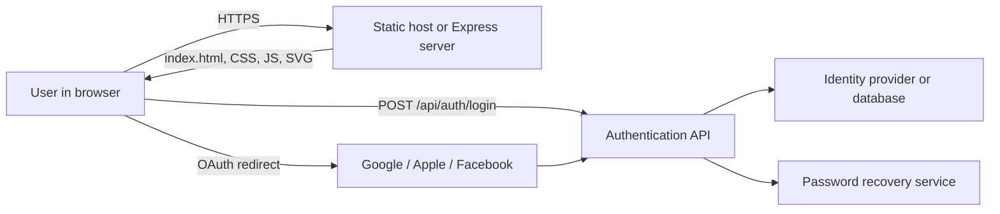
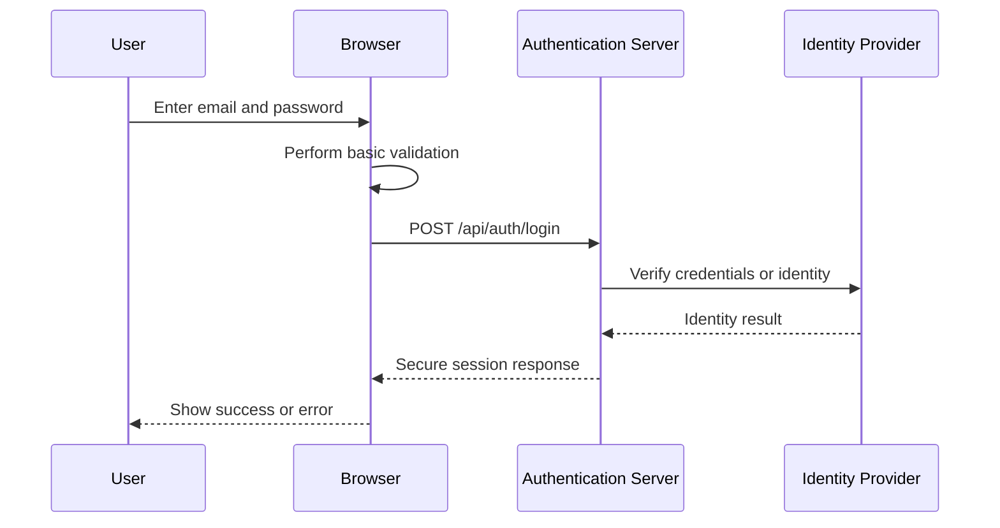

# Architecture

## 1. Document Status and Source of Truth

`problemStatement.md` was not present in the `Satyain10/FirstProject` repository when this document was generated. This architecture therefore describes the implementation visible in the repository today and provides a proposed architecture for completing the product shown by the login-page reference image.

The current repository is a small JavaScript/HTML application. The primary user-facing deliverable is a responsive sign-in page with a winter landscape illustration.

## 2. Project Goals

### 2.1 Functional Goals

- Render a polished sign-in page on desktop and mobile devices.
- Collect an email address and password.
- Validate fields using browser-native and application-level validation.
- Allow users to reveal or hide the password.
- Present password-recovery and social sign-in actions.
- Return clear success, error, loading, and validation states.
- Authenticate users securely through a server-side identity service.
- Provide password recovery and OAuth sign-in if backend credentials are configured.

### 2.2 Non-Functional Goals

- Responsive layout for desktop, tablet, and mobile viewports.
- Semantic, keyboard-accessible HTML.
- Minimal initial load: no framework requirement for the current static interface.
- Secure handling of credentials; passwords must never be stored or logged in browser JavaScript.
- Deployment compatibility with GitHub Pages or a Node.js host.
- A clear separation between presentation, client behavior, API communication, and authentication.

## 3. Current Repository Structure

```text
.
├── index.html     # Page markup, embedded CSS, SVG illustration, and browser interactions
├── server.js      # Express server for local/Node hosting
├── package.json   # npm scripts and Express dependency
├── bun.lock       # Bun dependency lock file
└── metadata.json  # Application name and description metadata
```

## 4. System Context



The current implementation does not contain an authentication API or database. Its form submission and social-provider buttons are UI demonstrations only.

## 5. Current Runtime Architecture

### 5.1 Browser Runtime

`index.html` owns the following responsibilities:

1. Document metadata and external Inter font loading.
2. Page layout and responsive styling.
3. Sign-in form markup and native email/password constraints.
4. Password visibility toggling.
5. A placeholder sign-in submission handler.
6. Placeholder social-provider button feedback.
7. A custom SVG winter landscape illustration.

### 5.2 Node Runtime

`server.js` is an Express 5 application that:

- Starts on `PORT`, defaulting to `3000`.
- Binds to `0.0.0.0` for container compatibility.
- Returns `204 No Content` for `/favicon.ico`.
- Serves `index.html` for `/` and `/index.html`.

There is no server-side routing or middleware for authentication in the current implementation.

## 6. Component Architecture

For maintenance and testing, the page should be split into named components or modules:

```text
App / Page
├── SignInPanel
│   ├── PageHeading
│   ├── TrialSubtitle
│   ├── SignInForm
│   │   ├── EmailField
│   │   ├── PasswordField
│   │   ├── PasswordVisibilityButton
│   │   ├── RecoveryPasswordLink
│   │   └── SubmitButton
│   ├── FormStatus
│   ├── ProviderDivider
│   └── SocialSignInGroup
│       ├── GoogleButton
│       ├── AppleButton
│       └── FacebookButton
└── LandscapePanel
    ├── Sun
    ├── Birds
    ├── SVGLand
    ├── Caption
    └── CarouselDots
```

The landscape should remain decorative and use `aria-hidden="true"` or an appropriate accessible label. The form and social actions must remain exposed to assistive technology.

## 7. Proposed File Organization

For the next implementation stage, a feature-oriented structure is recommended:

```text
.
├── public/
│   ├── index.html
│   ├── styles.css
│   └── assets/
│       └── landscape.svg
├── src/
│   ├── app.js
│   ├── components/
│   │   ├── SignInForm.js
│   │   ├── PasswordField.js
│   │   ├── SocialSignIn.js
│   │   └── LandscapePanel.js
│   ├── services/
│   │   └── auth.js
│   └── utils/
│       └── validation.js
├── server/
│   ├── app.js
│   ├── routes/
│   │   └── auth.routes.js
│   ├── controllers/
│   │   └── auth.controller.js
│   └── middleware/
│       └── error.middleware.js
├── tests/
│   ├── auth.test.js
│   └── sign-in-page.test.js
├── package.json
├── server.js
└── architecture.md
```

The initial project may keep CSS and JavaScript inline, but maintainability improves significantly after separating visual styles and behavior from `index.html`.

## 8. Authentication Architecture

A production implementation should use an established identity provider or a server-side authentication system.

Recommended data flow:



Recommended security practices:

- Never store plaintext passwords in the repository or browser.
- Hash passwords with Argon2 or bcrypt when credentials are stored locally.
- Use server-managed, HTTP-only, Secure, SameSite cookies for sessions.
- Use CSRF protection for cookie-based authentication.
- Apply rate limiting to login and password-recovery endpoints.
- Return generic authentication errors to avoid account enumeration.
- Validate the email server-side as well as in the browser.
- Configure OAuth redirect URLs for the exact production origin.
- Add appropriate security headers and HTTPS-only cookies.
- Do not send credentials in URL query parameters or error logs.

## 9. API Design

The following endpoints are recommended for a complete implementation.

### 9.1 Email Sign-In

`POST /api/auth/login`

Request:

```json
{
  "email": "user@example.com",
  "password": "********",
  "rememberMe": false
}
```

Expected successful response:

```json
{
  "authenticated": true,
  "redirectTo": "/dashboard"
}
```

Expected validation response:

```json
{
  "error": {
    "code": "INVALID_CREDENTIALS",
    "message": "Email or password is incorrect."
  }
}
```

### 9.2 Password Recovery

`POST /api/auth/password-reset/request`

Request:

```json
{
  "email": "user@example.com"
}
```

The response should not disclose whether an account exists.

### 9.3 Social Sign-In

`GET /api/auth/oauth/google`

`GET /api/auth/oauth/apple`

`GET /api/auth/oauth/facebook`

The server should begin the OAuth authorization flow and the provider should redirect back to a server-side callback before creating a session.

## 10. State and Validation Model

### 10.1 Form States

- `idle`: Initial empty or partially completed form.
- `editing`: User is updating a field.
- `invalid`: One or more fields fail validation.
- `submitting`: Request is active and submit is disabled.
- `success`: Authentication succeeded and navigation is starting.
- `error`: Authentication failed or the server is unavailable.

### 10.2 Validation Rules

- Email is required.
- Email must match the HTML email constraint and should also be validated server-side.
- Password is required.
- Password validation should follow the identity provider or product policy.
- Social provider failures must display a useful but non-sensitive message.
- Every submitted request should have a visible loading and terminal state.

## 11. Responsive Layout Architecture

### Desktop

- White card centered in the viewport.
- Width of approximately 1080px.
- Minimum card height of approximately 620px.
- Sign-in panel: approximately 42.5% of the card.
- Landscape panel: approximately 57.5% of the card.
- Card and landscape rounded corners match the reference image.

### Mobile

- Card is stacked vertically.
- Form panel retains usable touch targets and spacing.
- Landscape is reduced to a decorative 280px-height section.
- Page background must not create horizontal overflow.
- Form controls remain at least 44px tall.

### Accessibility

- Labels must be associated with inputs, including hidden labels for compact visual designs.
- Password visibility control needs a stable accessible name.
- Form status should use `role="status"` or `aria-live="polite"`.
- Errors should use `aria-describedby` and `aria-invalid` where applicable.
- Buttons must have visible focus and hover states.
- Do not convey validation or status only through color.
- Landscape SVG should not interfere with screen readers or keyboard navigation.

## 12. Deployment Architecture

### 12.1 Static Deployment

For the current UI-only implementation, GitHub Pages is suitable:

- Build: none required.
- Published source: repository `main` branch, root directory.
- Entry file: `index.html`.
- Public URL: `https://satyain10.github.io/FirstProject/`.

GitHub Pages cannot run the Express server or provide secure secrets. It is appropriate for the current visual prototype only.

### 12.2 Node Deployment

For authentication and password recovery:

- Run `npm install` or `bun install`.
- Set `PORT` and authentication environment variables.
- Run `npm start`.
- Use HTTPS and a managed secret store.
- Reverse-proxy through a platform load balancer or application gateway.
- Store session data in a secure server-side store if sessions are not stateless.

### 12.3 Configuration

Recommended environment variables:

```text
PORT=3000
APP_URL=https://example.com
AUTH_SESSION_SECRET=<secret>
GOOGLE_CLIENT_ID=<id>
GOOGLE_CLIENT_SECRET=<secret>
APPLE_CLIENT_ID=<id>
APPLE_CLIENT_SECRET=<secret>
FACEBOOK_CLIENT_ID=<id>
FACEBOOK_CLIENT_SECRET=<secret>
PASSWORD_RESET_URL=https://example.com/reset-password
```

No secrets should be placed in `index.html`, `metadata.json`, or committed `.env` files.

## 13. Build and Quality Pipeline

### Package Scripts

The existing scripts are:

- `npm run dev`: start Express locally.
- `npm start`: start Express locally.
- `npm run build`: currently syntax-check only `server.js`.
- `npm run lint`: currently syntax-check only `server.js`.

Recommended additions:

```text
npm test
npm run test:ui
npm run test:a11y
npm run check
```

### Test Coverage

- HTML structure and required form controls.
- Email validation behavior.
- Password visibility toggling.
- Loading, success, and error states.
- Mobile and desktop responsive snapshots.
- Keyboard navigation and focus visibility.
- OAuth redirect and callback handling.
- Invalid login, rate limiting, and password-recovery behavior.
- Session creation, expiration, logout, and CSRF protection.

## 14. Implementation Plan

### Phase 1: Stabilize the UI

1. Improve semantic labels and accessible status messages.
2. Separate inline CSS and JavaScript into maintainable files.
3. Replace the synthetic landscape only if a production-approved asset is available.
4. Add a no-JavaScript or graceful-degradation fallback if required.

### Phase 2: Add Client Behavior

1. Create a validation module.
2. Implement field-level errors.
3. Disable the submit button while a request is active.
4. Prevent duplicate submissions.
5. Handle network failures without exposing technical details.

### Phase 3: Add Authentication

1. Choose an identity provider or database-backed authentication approach.
2. Implement login, logout, session, and password-recovery endpoints.
3. Integrate Google, Apple, and Facebook OAuth.
4. Add CSRF and rate-limiting middleware.
5. Add security, privacy, and account-linking behavior.

### Phase 4: Production Readiness

1. Add automated unit, integration, UI, and accessibility tests.
2. Add observability and privacy-safe error logging.
3. Configure HTTPS and secrets in the deployment platform.
4. Run accessibility and performance audits.
5. Document deployment and operational procedures.

## 15. Risks and Mitigations

| Risk | Impact | Mitigation |
|---|---|---|
| UI-only implementation presented as authentication | Security and user-expectation issue | Clearly label prototype behavior and implement a real server before production |
| Password or session handling implemented incorrectly | Account compromise | Use a mature identity provider or security-reviewed server implementation |
| Third-party OAuth configuration incomplete | Social buttons fail | Configure and test provider credentials and redirect URLs |
| Google Fonts unavailable | Layout font fallback changes | Add a local font or an appropriate system-font fallback |
| Static hosting cannot run authentication | Login and recovery cannot work securely | Deploy the server to a Node-compatible platform |
| Inline SVG is not optimized | Larger markup and maintenance difficulty | Extract and optimize assets or use a reviewed image asset |
| Missing problem statement | Requirements may be inferred incorrectly | Add `problemStatement.md` to the repository and align this document with it |

## 16. Acceptance Criteria

The project should be considered complete when:

1. The page matches the provided reference across supported desktop and mobile sizes.
2. Email and password fields are accessible and correctly labeled.
3. Validation and loading states are visible and usable.
4. Password reveal/hide interaction works correctly.
5. Password recovery opens a real recovery flow.
6. Social sign-in buttons use real provider integrations or are intentionally hidden until configured.
7. Authentication occurs on the server and credentials are never logged or stored insecurely.
8. The application works over HTTPS in its deployed environment.
9. Automated tests cover critical form and authentication behavior.
10. `problemStatement.md` is added and this architecture is revised against its exact requirements.
